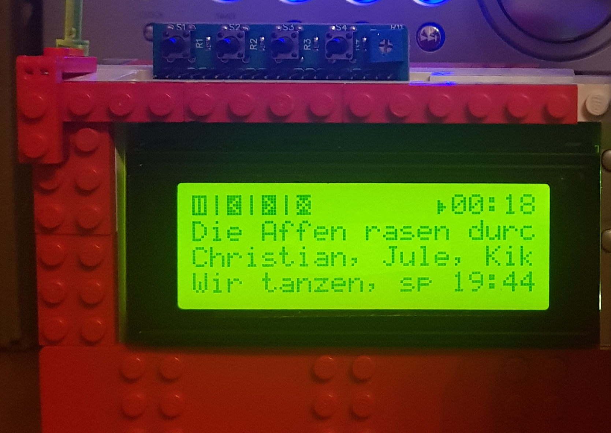
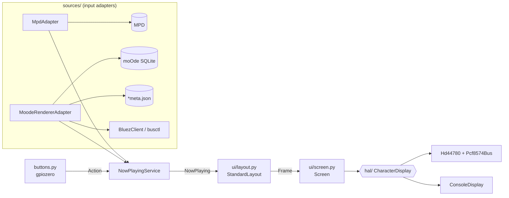

# moode-charlcd

[](https://github.com/maystar/moode-charlcd/actions/workflows/ci.yml)

Shows what the [moOde audio player](https://moodeaudio.org) is playing on a character LCD and
handles hardware buttons (play/pause, previous, next).

Built for the [Joy-IT RB-LCD-20x4](https://www.joy-it.net/de/products/RB-LCD-20x4) (HD44780
behind a PCF8574 I2C expander) on a Raspberry Pi 4. The display side is abstracted, so other
character displays only need a small driver. Successor of
[mopidy-charlcd](https://github.com/maystar/mopidy-charlcd).



> **Status:** Version 0.2.1 runs on a Raspberry Pi 4 with moOde 10 and the Joy-IT RB-LCD-20x4.
> Display, umlauts, buttons, shutdown button, MPD (library and radio, reconnect after an MPD
> restart) and Spotify Connect are tested on the device; Bluetooth is not tested yet.

## Screen layout

On a 20x4 display:

```
⏸|⏮|⏭|⏻   ∞⤨© ►01:23    button legend │ repeat, random, consume │ playing, elapsed time
Gasoline                title
Audioslave              artist
Audioslave     12:34    album │ clock
```

- The legend shows what the buttons do right now; buttons without a function are left blank.
- Without buttons, or for renderers that cannot be controlled, the renderer name (e.g.
  `Spotify`) replaces the legend.
- Smaller displays (e.g. 16x2) drop the option symbols and the clock.
- When the service stops (e.g. on shutdown) the display shows `Und tschüss!`.

## Sources

| Source | Information | Buttons |
|---|---|---|
| MPD (library, radio, UPnP/DLNA) | title, artist, album, elapsed time, repeat/random/consume | play/pause, previous, next |
| Bluetooth (phone etc.) | title, artist, album, elapsed time | play/pause, previous, next |
| Spotify Connect, AirPlay, Qobuz | title, artist, album | – |
| Squeezelite, Roon, Plexamp, inputs, multiroom receiver | renderer name | – |

- **MPD** is followed through its `idle` events, so changes in the moOde web UI show up
  immediately. For radio streams the station is shown as album and a stream title of the form
  `Artist - Title` is split.
- **moOde renderers** are detected from moOde's database (`cfg_system`, flags such as
  `spotactive`, opened read-only) and its metadata files (`/var/local/www/spotmeta.json`,
  `aplmeta.json`, …). No moOde setting has to be enabled.
- **Bluetooth** players are read and controlled through BlueZ (`org.bluez.MediaPlayer1`) using
  `busctl`.

## Hardware

| Function | Pin (BCM) | Handled by |
|---|---|---|
| LCD | I2C bus 1, address `0x27` | moode-charlcd |
| Play/pause | GPIO 4 | moode-charlcd |
| Previous | GPIO 16 | moode-charlcd |
| Next | GPIO 10 | moode-charlcd |
| Shutdown | GPIO 9 | kernel overlay `gpio-shutdown` |

Buttons connect the pin to GND; the internal pull-up resistor is used.

Two PCF8574 wirings are supported (`pin_mapping`):

| Mapping | P7 | P6 | P5 | P4 | P3 | P2 | P1 | P0 |
|---|---|---|---|---|---|---|---|---|
| `standard` (most backpacks) | D7 | D6 | D5 | D4 | Backlight | EN | RW | RS |
| `joyit` (Joy-IT RB-LCD-20x4) | EN | – | – | RS | D7 | D6 | D5 | D4 |

## Installation

On the Pi the service is installed by the provisioning script `23-install-moode-charlcd.sh`
(branch `moodeaudio` of `nc-server-provisioning`). Manually:

```sh
sudo apt install git python3-venv python3-mpd python3-smbus2 python3-gpiozero python3-lgpio i2c-tools
sudo python3 -m venv --system-site-packages /opt/moode-charlcd/venv
sudo /opt/moode-charlcd/venv/bin/pip install --no-deps "git+https://github.com/maystar/moode-charlcd@v0.2.1"
```

The shutdown button is not part of this service. Script `24-config-shutdown-button.sh` adds it
to `/boot/firmware/config.txt` (moOde already sets `dtparam=i2c_arm=on`); manually add the
following lines and reboot:

```
# Shutdown with gpio 9
dtoverlay=gpio-shutdown,gpio_pin=9,active_low=1,gpio_pull=up
```

Keep moOde's own *GPIO buttons* and *LCD updater* (Configure › Peripherals) switched off,
otherwise button presses are handled twice.

Releases are Git tags (`vX.Y.Z`); the package is not published on PyPI.

## Configuration

`/etc/moode-charlcd.toml` overrides the defaults in
[`moode_charlcd/default_config.toml`](moode_charlcd/default_config.toml) key by key:

```toml
[display]
cols = 20
rows = 4
refresh_hz = 4
goodbye = "Und tschüss!"
console_mirror = false        # also print the screen to stdout (journal)

[display.hd44780-pcf8574]
i2c_bus = 1
i2c_address = 0x27
pin_mapping = "joyit"         # or "standard"
charset = "A00"               # character ROM: "A00" (Japanese) or "A02" (European)

[mpd]
host = "localhost"
port = 6600

[moode]
enabled = true                # detect Spotify, AirPlay, Bluetooth, ...

[bluetooth]
enabled = true                # metadata and control via BlueZ

[buttons]
enabled = true
bounce_ms = 250

[buttons.pins]                # replaced as a whole; remove a line to disable a button
play_pause = 4
previous = 16
next = 10
```

## Usage

```
moode-charlcd [--config FILE] [--display {hd44780-pcf8574,console}] [--console] [--log-level LEVEL]
```

| Option | Effect |
|---|---|
| `--config FILE` | configuration file (default `/etc/moode-charlcd.toml`) |
| `--display console` | print the screen to the terminal instead of using the LCD |
| `--console` | mirror the LCD to stdout |
| `--log-level DEBUG` | verbose logging |

With the provisioning script the service runs as systemd unit `moode-charlcd`:

```sh
sudo systemctl restart moode-charlcd   # after changing the configuration
journalctl -u moode-charlcd -f         # log
```

## Architecture



| Layer | Package | Responsibility |
|---|---|---|
| Model | `model.py` | `NowPlaying` (source independent, incl. supported button actions), elapsed time interpolation |
| Input | `sources/` | `PlayerAdapter` implementations; data access through small repositories/clients that are replaced by fakes in tests |
| Service | `service.py` | adapters ordered by priority (renderers before MPD), first active one wins; routes button actions |
| Layout | `ui/layout.py` | `NowPlaying` → `Frame` (grid of characters and symbols), no hardware knowledge |
| Screen | `ui/screen.py` | symbols → built-in characters, programmable slots or ASCII fallback; text encoding; transfers only changes |
| HAL | `hal/` | display drivers implementing `CharacterDisplay` |

### Adding a display

Implement `moode_charlcd.hal.base.CharacterDisplay`:

| Method | Required | Purpose |
|---|---|---|
| `encode_char(char)` | yes | one code per character (substitute unknown characters) |
| `write(row, col, codes)` | yes | write codes on one row |
| `clear()` | yes | blank the display |
| `custom_char_slots`, `define_char(slot, bitmap)` | no | programmable 5x8 characters |
| `builtin_symbol(symbol)` | no | symbols present in the character ROM |
| `flush()`, `close()` | no | buffered displays, cleanup |

Then register it in [`hal/factory.py`](moode_charlcd/hal/factory.py). An HD44780 behind a
different bus (e.g. direct GPIO) only needs a new `NibbleBus` for
[`hal/hd44780.py`](moode_charlcd/hal/hd44780.py).

### Adding a source

Implement `moode_charlcd.sources.base.PlayerAdapter` (or `PollingAdapter` for periodic polling)
returning `NowPlaying` while active and `None` otherwise, and add it in `build_adapters()` in
[`app.py`](moode_charlcd/app.py).

## Development

Requires Python ≥ 3.11. Target is moOde 10 (Raspberry Pi OS Trixie, Python 3.13); moOde 9
(Bookworm, Python 3.11) should work as well.

```sh
python3 -m venv .venv && . .venv/bin/activate
pip install -e ".[dev]"

ruff check .            # lint
ruff format .           # format
mypy                    # type check (strict)
pytest --cov            # tests with coverage

moode-charlcd --display console --config /dev/null   # run without hardware
```

The tests need no hardware: I2C bus, MPD client, `busctl`, GPIO buttons and the moOde database are
replaced by fakes or temporary files. GitHub Actions runs lint, type check and tests on every push
and pull request.

## License

Apache License 2.0, see [LICENSE](LICENSE). The HD44780/PCF8574 driver is derived from
[I2C_HD77480_LCD](https://github.com/maystar/I2C_HD77480_LCD) (based on work by Dan Halbert and
[RPLCD](https://github.com/dbrgn/RPLCD) by Danilo Bargen, MIT).
