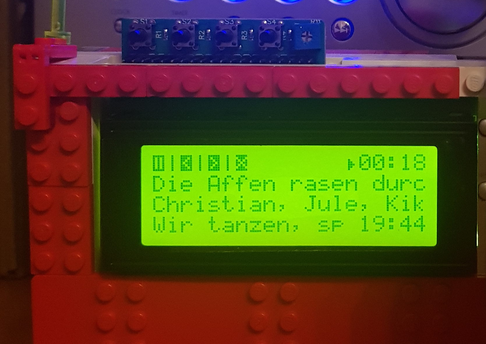

****************************
moode-charlcd
****************************

Shows what the `moOde audio player <https://moodeaudio.org>`_ is playing on a
character LCD and handles hardware buttons (play/pause, previous, next).

Built for the `Joy-IT RB-LCD-20x4 <https://www.joy-it.net/de/products/RB-LCD-20x4>`_
(HD44780 behind a PCF8574 I2C expander) on a Raspberry Pi 4, but the display
side is abstracted so other character displays need only a small driver.
Successor of `mopidy-charlcd <https://github.com/maystar/mopidy-charlcd>`_.

Screen layout (20x4)::

    ⏸|⏮|⏭|⏻   ∞⤨© ►01:23      button legend, repeat/random/consume, elapsed time
    Gasoline                  title
    Audioslave                artist
    Audioslave     12:34      album, clock

Sources
=======

========================  ===========================  ===============
Source                    Information                  Buttons
========================  ===========================  ===============
MPD (library, radio,      title, artist, album,        play/pause,
UPnP)                     elapsed time, options        previous, next
Bluetooth                 title, artist, album,        play/pause,
                          elapsed time (BlueZ AVRCP)   previous, next
Spotify Connect, AirPlay  title, artist, album         –
Squeezelite, Roon, ...    renderer name                –
========================  ===========================  ===============

MPD is followed via its ``idle`` events. Active moOde renderers are read from
moOde's database (``cfg_system``, read-only) and its metadata files
(``/var/local/www/*meta.json``). Bluetooth players are queried with ``busctl``.

Installation
============

The service is installed by the provisioning script
``23-install-moode-charlcd.sh`` (branch ``moodeaudio`` of
``nc-server-provisioning``). Manually::

    sudo apt install python3-venv python3-smbus2 python3-gpiozero python3-lgpio
    sudo python3 -m venv --system-site-packages /opt/moode-charlcd/venv
    sudo /opt/moode-charlcd/venv/bin/pip install "git+https://github.com/maystar/moode-charlcd@v0.1.0"

The shutdown button (GPIO 9) is handled by the kernel, add to
``/boot/firmware/config.txt``::

    dtoverlay=gpio-shutdown,gpio_pin=9,active_low=0

Configuration
=============

``/etc/moode-charlcd.toml`` overrides the defaults in
`moode_charlcd/default_config.toml <moode_charlcd/default_config.toml>`_, e.g.::

    [display.hd44780-pcf8574]
    i2c_address = 0x27
    pin_mapping = "joyit"   # or "standard" for common backpacks

    [buttons.pins]
    play_pause = 4
    previous = 16
    next = 10

Command line::

    moode-charlcd [--config FILE] [--display console] [--console] [--log-level DEBUG]

``--display console`` prints the screen instead of using the LCD,
``--console`` mirrors the LCD to stdout (visible in ``journalctl``).

Architecture
============

::

    sources/ (input adapters)          service.py           ui/ (layout)         hal/ (drivers)
    MpdAdapter ───────────┐                                 StandardLayout       Hd44780 + Pcf8574Bus
    MoodeRendererAdapter ─┼─> NowPlaying ─> NowPlayingService ─> Frame ─> Screen ─> ConsoleDisplay
      MoodeDatabase       │                     ▲                                 (your driver)
      MetadataFiles       │                     │
      BluezClient         │            buttons.py (gpiozero)
                          └─ ordered by priority, first active wins

* **Input adapters** (``moode_charlcd/sources``) implement ``PlayerAdapter``
  and translate one kind of source into the common ``NowPlaying`` model. Data
  access goes through small repositories/clients that are replaced by fakes in
  the tests.
* **Layout** (``moode_charlcd/ui/layout.py``) turns ``NowPlaying`` into a
  ``Frame`` (grid of characters and symbols), independent of hardware.
* **Screen** (``moode_charlcd/ui/screen.py``) maps symbols to built-in or
  programmable characters, encodes text and only transfers changes.
* **HAL** (``moode_charlcd/hal``): a display driver implements
  ``CharacterDisplay`` (``encode_char``, ``write``, ``clear``, optionally
  ``define_char``/``builtin_symbol``) and is registered in ``hal/factory.py``.

Development
===========

::

    python3 -m venv .venv && . .venv/bin/activate
    pip install -e ".[dev]"
    ruff check . && ruff format --check . && mypy && pytest --cov
    moode-charlcd --display console --config /dev/null

Releases are Git tags (``vX.Y.Z``); the package is not published on PyPI.

License
=======

Apache License 2.0. The HD44780/PCF8574 driver is derived from
`I2C_HD77480_LCD <https://github.com/maystar/I2C_HD77480_LCD>`_ (Dan Halbert,
based on `RPLCD <https://github.com/dbrgn/RPLCD>`_ by Danilo Bargen, MIT).
